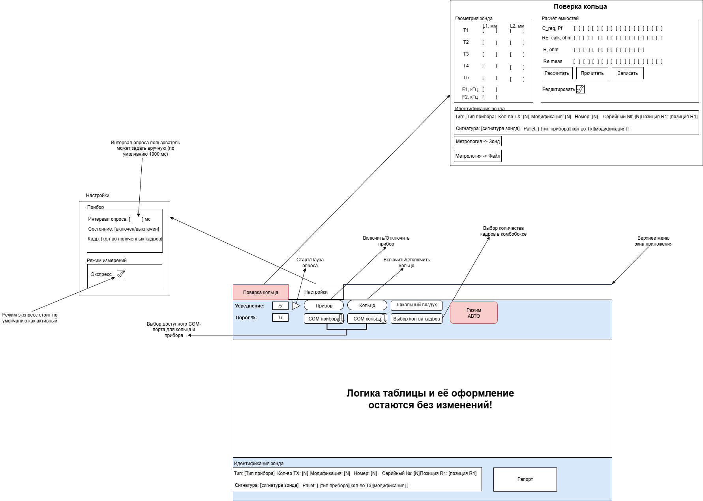

# LOOP Next: план переноса и рефакторинга

Дата обновления: 2026-06-26
Статус: перенесена логика подключения кольца и прибора из `LOOP_NEW` с логированием и пользовательскими сообщениями об ошибках; кнопки `Прибор`/`Кольцо` теперь меняют цвет (зелёный — отключено, красный — подключено).

Этот файл является рабочей документацией миграции. Его нужно обновлять после каждого значимого шага: анализа, переноса модуля, изменения архитектурного решения, успешной проверки или обнаруженного риска.

## 1. Цель миграции

Перенести работоспособную логику старого приложения `LOOP_NEW` из C++/CLI Windows Forms в современное C# / WinUI 3 приложение `LOOP_NEXT` с модульной архитектурой, сохранив критичное поведение измерений, обмена с прибором, расчётов, метрологии, таблицы и отчётов.

Итоговое приложение должно:

- запускаться как обычный `.exe`;
- поддерживаться и отлаживаться в Visual Studio 2026;
- собираться в установщик для сотрудников предприятия;
- устанавливать ярлык на рабочий стол;
- появляться в поиске приложений Windows;
- не требовать ручной установки Windows App Runtime на рабочих ПК;
- иметь современный профессиональный интерфейс на WinUI 3;
- не тащить мёртвый код из старого проекта.

## 2. Текущее состояние нового проекта

- [x] Создан новый проект на рабочем столе: `C:\Users\Admin\Desktop\LOOP_NEXT`.
- [x] Создано решение: `LOOP_NEXT.sln`.
- [x] Основное приложение создано как WinUI 3 / C# / Windows App SDK: `src\LOOP.Next.App`.
- [x] Добавлены модульные библиотеки:
  - `src\LOOP.Next.Core`;
  - `src\LOOP.Next.Hardware`;
  - `src\LOOP.Next.Metrology`;
  - `src\LOOP.Next.Reporting`.
- [x] Настроена конфигурация `Debug|x64` и `Release|x64`.
- [x] Настроен запуск `.exe`: `LOOP.Next.exe`.
- [x] Исправлена проблема запуска из-за отсутствующего Windows App Runtime: включён `WindowsAppSDKSelfContained`.
- [x] Проверена сборка `Debug|x64`: 0 ошибок, 0 предупреждений.
- [x] Проверен фактический запуск окна `LOOP Next`.
- [x] Создать каркас UI по новой схеме (`Главная`, `Поверка кольца`, `Настройки`, панель инструментов, таблица, идентификация).
- [x] Протестировать подключение реального прибора и чтение данных.
- [ ] Перенести и покрыть проверками расчётную логику.
- [x] Перенести COM-обмен и работу с прибором.
- [x] Перенести подключение/отключение кольца и логирование ошибок из `LOOP_NEW`.
- [x] Добавить индикацию состояния кнопок `Прибор`/`Кольцо` (зелёный — отключено, красный — подключено).
- [ ] Перенести метрологию зонда и кольца (геометрия/расчёт ёмкостей/чтение R-Re кольца перенесены; запись и файл ещё впереди).
- [x] Воссоздать основную таблицу расчётных и измеренных сопротивлений в стиле старого приложения.
- [ ] Подключить расчётные значения `УЭС` и `R1..R8` к перенесённой логике (`УЭС` подключено; `R1..R8` зависят от переноса эталонов кольца).
- [ ] Перенести генерацию отчёта.
- [ ] Настроить финальный publish и установщик.

## 3. Целевая архитектура

### 3.1. `LOOP.Next.App`

Ответственность: WinUI 3 интерфейс, окна, страницы, привязки, команды, визуальные состояния, пользовательские настройки UI.

Планируемая структура:

- `Pages/` — основные экраны приложения;
- `Views/` или `Controls/` — переиспользуемые UI-блоки;
- `ViewModels/` — состояние экранов и команды;
- `Services/` — адаптеры к доменным сервисам, навигация, диалоги, настройки;
- `Styles/` — общие стили, ресурсы темы, оформление таблицы;
- `Assets/` — иконки и графические ресурсы.

### 3.2. `LOOP.Next.Core`

Ответственность: общие модели, типы данных, константы, результатные типы, правила индексации, базовые доменные структуры.

Сюда должны переехать:

- структуры данных прибора и зонда;
- модели измерительных кадров;
- модели состояния прибора/кольца;
- типы ошибок обмена;
- общие правила работы с количеством передатчиков `N_Tx`;
- общие настройки измерения.

### 3.3. `LOOP.Next.Hardware`

Ответственность: взаимодействие с внешним оборудованием.

Сюда должны переехать:

- COM-порты прибора и кольца;
- протокол команд;
- CRC;
- чтение полного пакета с учётом timeout;
- подключение/отключение прибора;
- подключение/отключение кольца;
- получение кадров измерений;
- получение сигнатуры и идентификационных данных;
- режим работы через DLL для автономного прибора, если он остаётся актуальным.

### 3.4. `LOOP.Next.Metrology`

Ответственность: расчёты, поверка, геометрия, локальный воздух, преобразование фаз в сопротивления/УЭС.

Сюда должны переехать:

- геометрия зонда: `L1`, `L2`, `F1`, `F2`;
- расчёт ёмкостей и сопротивлений кольца;
- метрологические данные зонда;
- локальный воздух;
- расчёт `ro_dfi` и связанных величин;
- нормализация фаз;
- ориентация фаз по `Rx_Position`;
- расчёт итоговых значений таблицы.

### 3.5. `LOOP.Next.Reporting`

Ответственность: формирование отчётов и подготовка данных отчёта.

Сюда должны переехать:

- модель отчёта;
- сбор данных из таблицы и идентификации зонда;
- правила окраски/оценки, если они входят в отчёт;
- экспорт в целевой формат, который будет выбран отдельно.

## 4. Источники старой логики

Первичные файлы старого проекта для анализа и переноса:

- `C:\Users\Admin\Desktop\LOOP_NEW\LOOP\WorkForm.h` — основной UI, цикл опроса, таблица, связка измерений с отображением.
- `C:\Users\Admin\Desktop\LOOP_NEW\LOOP\function.cpp` — протокол, фазовая логика, расчёты, преобразования.
- `C:\Users\Admin\Desktop\LOOP_NEW\LOOP\variable.h` — команды, структуры, глобальные типы и константы.
- `C:\Users\Admin\Desktop\LOOP_NEW\LOOP\Lopp.cpp` — глобальные переменные и стартовые состояния.
- `C:\Users\Admin\Desktop\LOOP_NEW\LOOP\MetroForm.h` — метрология и поверка.
- `C:\Users\Admin\Desktop\LOOP_NEW\LOOP\doc\LOOP_NEW_DOCUMENTATION.md` — текущая инженерная документация старого приложения.

Правило переноса: сначала понять фактическое поведение в старом коде, затем переносить минимальный рабочий фрагмент в новый модуль, затем проверять сборкой и тестами/ручной проверкой.

## 4.1. Подтверждённые правила переноса UI и поведения

Подтверждено пользователем 2026-06-25:

- новая схема описывает только новую организацию элементов приложения;
- вся бизнес-логика, расчёты, сценарии работы, режимы и поведение должны остаться прежними;
- `Поверка кольца` в текущей версии представлена отдельной вкладкой/рабочей областью; перенос логики поверки выполняется без изменения старого поведения;
- `Режим АВТО` — это старый режим из текущего приложения, его поведение переносится без изменения;
- `Локальный воздух` работает так же, как в старом приложении;
- список значений выбора количества кадров должен быть таким же, как в старом приложении;
- любые отличия от старого поведения допустимы только после отдельного согласования.

Практическое правило: если новая схема и старый код конфликтуют, схема задаёт расположение/группировку элементов, а старый код задаёт поведение.
## 5. Новая схема интерфейса

Актуальная схема от пользователя сохранена здесь:

Основные требования из схемы:

- верхнее меню окна приложения остаётся в верхней части;
- верхняя область содержит вкладки `Главная`, `Поверка кольца`, `Настройки`; вкладка `Главная` активна при запуске;
- на основной панели должны быть:
  - `Усреднение`;
  - `Порог %`;
  - старт/пауза опроса;
  - включить/отключить прибор;
  - включить/отключить кольцо;
  - действие `Локальный воздух`;
  - выбор COM-порта прибора;
  - выбор COM-порта кольца;
  - выбор количества кадров;
  - режим `АВТО`;
- интервал опроса и `Экспресс` вынесены из главной панели во вкладку `Настройки`;
- логика таблицы и её оформление должны соответствовать старому приложению;
- колонка `AIR` не заполняется демонстрационными значениями при старте и получает данные только после включения прибора/чтения метрологии;
- нижний блок идентификации зонда остаётся видимым на главном окне;
- кнопка `Рапорт` находится в нижней правой части;
- нижний информационный `InfoBar` не используется, так как признан избыточным;
- в настройках есть:
  - интервал опроса в миллисекундах, по умолчанию 1000 мс;
  - состояние прибора;
  - количество полученных кадров;
  - режим измерений `Экспресс`, включённый по умолчанию;
- во вкладке/рабочей области `Поверка кольца` должен быть перенесён полноценный сценарий поверки:
  - геометрия зонда `T1..T5`, `L1`, `L2`, `F1`, `F2`;
  - расчёт ёмкостей `C_req`, `RE_calc`, `R`, `Re_meas`;
  - действия `Рассчитать`, `Прочитать`, `Записать`;
  - режим редактирования;
  - идентификация зонда;
  - действия `Метрология -> Зонд` и `Метрология -> Файл`.

## 6. План работ

### Этап 1. Инвентаризация старого проекта

- [x] Найти и прочитать `.md` документацию старого проекта.
- [x] Зафиксировать ключевые области старого приложения: UI, COM, расчёты, метрология, отчётность.
- [x] Составить первичную карту старых функций: что переносим, что удаляем, что требует проверки.
- [ ] Отдельно отметить мёртвый код и устаревшие ветки, которые нельзя переносить автоматически.

### Этап 2. Базовый UI-каркас WinUI

- [x] Создать shell главного окна (`MainWindow.xaml` с MicaBackdrop).
- [x] Создать верхние вкладки по текущей схеме: `Главная`, `Поверка кольца`, `Настройки` (`TabView`).
- [x] Сделать вкладку `Главная` активной по умолчанию.
- [x] Реализовать фактическое переключение содержимого вкладок `Главная`, `Поверка кольца`, `Настройки`.
- [x] Создать горизонтальную панель инструментов главной вкладки: COM-порты, подключение/отключение прибора и кольца, старт/пауза опроса, локальный воздух, усреднение, порог, режим `АВТО`, рапорт.
- [x] Создать блок выбора COM-портов прибора и кольца.
- [x] Создать блок управления опросом на главной вкладке (старт/пауза); интервал перенесён во вкладку `Настройки`.
- [x] Создать блок локального воздуха (кадры, задать/сбросить, индикатор состояния).
- [x] Создать центральную таблицу расчётных и измеренных сопротивлений по образцу старого приложения.
- [x] Убрать демонстрационные значения из колонки `AIR` при старте приложения.
- [x] Заполнять колонку `AIR` по данным `GpToolMetrology.AirZz`, полученным после включения прибора.
- [x] Создать нижний блок идентификации зонда (тип, serial, сигнатура, N_Tx, Rx, модификация, номер, палитра, биты, кадров).
- [x] Убрать нижнюю пустую строку таблицы и избыточный нижний `InfoBar`.
- [x] Создать кнопку и команду `Рапорт` (placeholder).
- [x] Создать рабочие области вкладок `Поверка кольца` и `Настройки`.
- [x] Добавить вычисляемые свойства `CanConnect` / `CanConnectRing` для управления доступностью кнопок.
- [x] Протестировать подключение реального прибора и чтение данных end-to-end.
- [ ] Перенести полноценное содержимое поверки кольца (геометрия, расчёты и чтение R/Re перенесены; запись метрологии и файл остаются в этапе 7).
- [ ] Заложить светлую и тёмную тему через WinUI resources.
- [ ] Перенести окраску ячеек таблицы по порогам `do_graf` (зелёный/жёлтый/красный/тёмно-красный).

### Этап 3. Доменная модель и структуры данных

- [x] Перенести базовые бинарные модели данных прибора в `LOOP.Next.Core`.
- [x] Перенести базовую бинарную модель метрологии в `LOOP.Next.Core`.
- [x] Перенести первичную модель настроек измерения в `LOOP.Next.Core`.
- [x] Перенести модель строки таблицы.
- [x] Перенести модель идентификации зонда.
- [x] Убрать зависимость расчётов от UI-классов.

### Этап 4. Аппаратный слой

- [x] Реализовать перечисление COM-портов.
- [x] Реализовать подключение/отключение прибора.
- [x] Реализовать подключение/отключение кольца.
- [x] Перенести CRC и сборку пакета команд.
- [x] Перенести чтение полного ответа с timeout.
- [x] Перенести получение сигнатуры.
- [x] Перенести получение кадра измерений.
- [ ] Добавить диагностические сообщения ошибок связи.

Примечание: чтение/запись метрологии в прибор также перенесены (`MetrologyPort`), хотя относятся к Этапу 7.

### Этап 5. Расчётный слой

- [x] Перенести нормализацию фаз.
- [x] Перенести ориентацию фаз по `Rx_Position`.
- [x] Перенести применение локального воздуха.
- [x] Перенести расчёт УЭС/сопротивлений.
- [x] Перенести расчёт по количеству передатчиков `N_Tx`.
- [ ] Сравнить результаты нового расчёта со старым приложением на одинаковых входных данных.

### Этап 6. Таблица

- [x] Создать модель таблицы: `MeasurementTable`, `MeasurementTableRow`, `MeasurementCell`, `MeasurementQualityClassifier` (Core).
- [x] Подключить таблицу к `ResistanceTableRowViewModel` и отрисовать строки `T1..T5` для двух частот.
- [x] Проверить открытие таблицы по умолчанию без ожидания подключения прибора.
- [x] Подключить колонку `AIR` к метрологии прибора после включения.
- [x] Подключить live-расчёт колонки `УЭС` к `LoopResistivity.RoDfi(...)` после применения локального воздуха.
- [x] Перенести расчёт эталонных `PH_computed/Ro_computed` для будущего заполнения `R1..R8`.
- [ ] Перенести окраску ячеек по порогам `do_graf` (зелёный/жёлтый/красный/тёмно-красный).
- [x] Перенести базовое визуальное оформление графиков-индикаторов в строках таблицы (красный/жёлтый/зелёный/жёлтый/красный).
- [x] Перенести метки `T1..T5` с частотами передатчиков для стартового и подключённого состояния.
- [ ] Подключить усреднение, порог и реальные значения `R1..R8` к логике таблицы после переноса эталонов кольца.

### Этап 7. Рабочая область поверки кольца и метрология

- [x] Создать рабочий визуал вкладки `Поверка кольца` по схеме: геометрия, расчёт ёмкостей, R/Re, идентификация.
- [x] Подключить геометрию зонда из метрологии прибора (`L1`, `L2`, `F`) к вкладке `Поверка кольца`.
- [x] Перенести расчёт `C_req` и `RE_calc`.
- [x] Перенести чтение параметров кольца `ZREAD n` (`R`, `Re_meas`) из COM-порта.
- [ ] Перенести чтение метрологии из зонда.
- [ ] Перенести запись метрологии в зонд.
- [ ] Перенести чтение/запись метрологии из файла.
- [ ] Перенести расчёт ёмкостей кольца.
- [ ] Реализовать режим редактирования.
- [ ] Проверить сценарий `Метрология -> Зонд`.
- [ ] Проверить сценарий `Метрология -> Файл`.

### Этап 8. Отчётность

- [ ] Найти старый механизм формирования рапорта.
- [ ] Выделить модель данных отчёта.
- [ ] Реализовать генерацию отчёта в новом модуле.
- [ ] Проверить соответствие отчёта старому приложению.

### Этап 9. Настройки и сохранение состояния

- [ ] Сохранять интервал опроса.
- [ ] Сохранять выбранные COM-порты, если это нужно пользователю.
- [ ] Сохранять режим `Экспресс`.
- [ ] Сохранять пользовательские параметры окна, если это не мешает работе.

### Этап 10. Упаковка и установка

- [ ] Настроить `Release|x64` publish.
- [ ] Проверить self-contained сборку.
- [ ] Выбрать инструмент установщика: Inno Setup или WiX.
- [ ] Создать ярлык на рабочем столе.
- [ ] Добавить приложение в меню Пуск и поиск Windows.
- [ ] Проверить установку на чистом ПК/профиле без ручной установки зависимостей.

## 7. Правила рефакторинга

- Не переносить старую глобальную архитектуру как есть.
- Не смешивать UI, COM-протокол и расчёты в одном классе.
- Сначала переносить поведение, затем улучшать оформление.
- Любое изменение расчётов должно иметь проверяемое основание.
- Логику таблицы переносить особенно осторожно: по схеме она должна остаться без изменений.
- Мёртвый код удалять только после подтверждения отсутствия вызовов и сценариев использования.
- После каждого значимого переноса выполнять сборку решения.
- После UI-изменений запускать приложение и проверять реальное окно.

## 8. Текущие открытые вопросы

- [x] `Поверка кольца` должна быть доступна отдельно от главного окна измерений. Решение: отдельная вкладка/рабочая область WinUI рядом с `Главная` и `Настройки`.
- [x] `Режим АВТО` — это старый режим из текущего приложения. Решение: переносить прежнее поведение без изменения.
- [x] `Локальный воздух` должен работать так же, как в старом приложении. Решение: сначала найти и перенести старый сценарий без изменения.
- [x] Количество кадров в комбобоксе должно иметь такие же значения, как в старом приложении. Решение: извлечь список из старого UI/логики.
- [ ] Рапорт должен формироваться в старом формате или можно выбрать новый формат после анализа старого механизма?
- [ ] Нужно ли сохранять выбранные COM-порты между запусками?

## 9. Карта переноса старого кода

Дата первичного составления: 2026-06-25.

### 9.1. Уже перенесено в новый проект

| Старый источник | Новый файл | Статус | Проверка |
| --- | --- | --- | --- |
| `variable.h:88-90` - `V10` | `src/LOOP.Next.Core/Models/BinaryStructs.cs` - `V10` | перенесено | `Marshal.SizeOf<V10>() = 40` |
| `variable.h:102-111` - `PHASE_ORIENTATION_DEBUG` | `src/LOOP.Next.Core/Models/PhaseOrientationDebug.cs` - `PhaseOrientationDebug` | перенесено как managed-модель диагностики | сборка `Debug|x64` успешна |
| `variable.h:116-129` - `INC_SET` | `src/LOOP.Next.Core/Models/BinaryStructs.cs` - `IncSet` | перенесено | `Marshal.SizeOf<IncSet>() = 48` |
| `variable.h:133-146` - `GP_TOOL_DATA` | `src/LOOP.Next.Core/Models/BinaryStructs.cs` - `GpToolData` | перенесено с `StructLayout(Pack=1)` и fixed-массивами | `Marshal.SizeOf<GpToolData>() = 240` |
| `variable.h:149-161` - `GP_TOOL_METROLOGY` | `src/LOOP.Next.Core/Models/BinaryStructs.cs` - `GpToolMetrology` | перенесено с `StructLayout(Pack=1)` и fixed-массивами | `Marshal.SizeOf<GpToolMetrology>() = 240` |
| `variable.h:171-182` - `SONDE_PARAM`, `LOOP_PARAM` | `src/LOOP.Next.Core/Models/DomainModels.cs` | перенесено как доменные структуры | сборка `Debug|x64` успешна |
| `variable.h:5-49` - команды и константы протокола | `src/LOOP.Next.Core/Protocol/ToolProtocolConstants.cs` | перенесено частично: активные команды и таймауты | сборка `Debug|x64` успешна |
| `MetroForm.h:1617-1624`, `MetroForm.h:1790-1797` - разбор сигнатуры | `src/LOOP.Next.Core/Models/ToolIdentity.cs` | перенесено как `ToolIdentity.Decode` | сборка `Debug|x64` успешна |
| `function.cpp:29-51` - `normalize_phase`, ориентация фаз по `Rx_Position` | `src/LOOP.Next.Metrology/PhaseMath.cs` | перенесено как чистые статические функции | сборка проекта Metrology успешна |
| `function.cpp:53` - `fill_phase_from_tool_data` | `src/LOOP.Next.Metrology/ToolPhaseProcessor.cs` | перенесено; глобальный `Rx_Position` заменён явным параметром | сборка проекта Metrology успешна |
| `function.cpp:81` - `metro_convert` | `src/LOOP.Next.Metrology/MetrologyConverter.cs` | перенесено; порядок `[freq][Tx]` сохранён | сборка проекта Metrology успешна |
| `function.cpp:101` - `dfi_from_loop` | `src/LOOP.Next.Metrology/LoopResistivity.cs` | перенесено на `System.Numerics.Complex` (double) | сборка проекта Metrology успешна |
| `function.cpp:116` - `dfi_ro` | `src/LOOP.Next.Metrology/LoopResistivity.cs` | перенесено на `System.Numerics.Complex` (double) | сборка проекта Metrology успешна |
| `function.cpp:123`, `function.cpp:153` - `ro_dfi` | `src/LOOP.Next.Metrology/LoopResistivity.cs` | перенесено: диапазон `0.01..7000`, возврат `7200` при INF-остановке | сборка проекта Metrology успешна |
| `function.cpp:163`, `function.cpp:182` - `calc_PH_from_loop`, `calc_Ro_from_loop` | `src/LOOP.Next.Metrology/LoopResistivity.cs` | перенесено: индексация `PH_computed[0]` как воздух, `R1..R8` в индексах `1..8` | сборка проекта Metrology успешна |
| `function.cpp:752`, `function.cpp:801` - `Z`, `C_max_fi` | `src/LOOP.Next.Metrology/RingCalibrationCalculator.cs` | перенесено: `L_loop=4.6e-6`, диапазон `500..70000 pF`, расчёт `C_req` и `RE_calc` | сборка проекта Metrology успешна |
| `complex<float>` в `dfi_*` | `src/LOOP.Next.Metrology/ComplexF.cs` | добавлен float-тип для точного совпадения с эталоном | сборка успешна |
| `function.cpp:835` - `CRC16` | `src/LOOP.Next.Hardware/Crc16.cs` | перенесено с идентичной таблицей, init `0xFFFF` | сборка Hardware успешна |
| `function.cpp:883`, `function.cpp:909` - `send_to_tool`, `receive_from_tool` | `src/LOOP.Next.Hardware/ToolSerialTransport.cs` | перенесено; формат пакета и коды `0/1/2` сохранены | сборка Hardware успешна |
| `function.cpp:296`, `function.cpp:318` - `read_tool_signature`, `get_ph_from_tool` | `src/LOOP.Next.Hardware/ToolPort.cs` | перенесено; длина ответа 245 байт, 1 повтор при timeout, `GP_TOOL_DATA` со смещения 2 | сборка Hardware успешна |
| `WorkForm.h:7809-7827` - список COM-портов | `src/LOOP.Next.Hardware/SerialPortEnumerator.cs` | перенесено: `SerialPort.GetPortNames()` | сборка Hardware успешна |
| `WorkForm.h:5876-6028` - вкл/выкл прибора | `src/LOOP.Next.Hardware/ToolConnection.cs` | перенесено: 125000 бод, 2000 мс, чтение метрологии 0x13 (3 попытки), `metro_convert` | сборка Hardware успешна |
| `WorkForm.h:6431` - `BT_ON` включение кольца | `src/LOOP.Next.Hardware/RingConnection.cs` | перенесено: 9600 бод, 500 мс, `"$\r\n"` -> ответ `"Unknown"` | сборка Hardware успешна |
| `WorkForm.h:6781`, `WorkForm.h:7456` - чтение `ZREAD n` | `src/LOOP.Next.Hardware/RingConnection.cs` | перенесено: чтение 10 ячеек `ZREAD`, парсинг `R/Re`, формирование `LoopParameter` при `Re > 0.000001` | сборка Hardware успешна |
| `MetroForm.h:1721`, `MetroForm.h:1835` - чтение/запись метрологии в зонд | `src/LOOP.Next.Hardware/MetrologyPort.cs` | перенесено: команда 0x13, направление по payload[0] (0x05/0xF5) | сборка Hardware успешна |
| `MetroForm.h:1790-1810` - разбор идентификации, `WorkForm.h:5667` `DeviceTypeDisplayName` | `src/LOOP.Next.Core/Models/SondeIdentification.cs` | перенесено: тип/N_Tx/мод/номер/serial/Rx, 32-битная сигнатура | сборка Core успешна |
| `WorkForm.h:5597` `do_graf` - структура и пороги ячейки | `src/LOOP.Next.Core/Models/MeasurementTable.cs` | перенесены модель таблицы/строки/ячейки и пороги качества (цвета — в UI) | сборка Core успешна |
| `WorkForm.h:6033-6065,6166-6242` - локальный воздух | `src/LOOP.Next.Metrology/LocalAirCorrector.cs` | перенесено: settle=5, выборка 1..200/20, baseline=среднее, `ph -= AIR` | сборка Metrology успешна |
| `MainWindow.xaml` — shell главного окна | `src/LOOP.Next.App/MainWindow.xaml` + `MainWindow.xaml.cs` | создано: MicaBackdrop, Frame, навигация на MainPage | запуск окна подтверждён |
| `MainPage.xaml` — каркас UI по схеме | `src/LOOP.Next.App/MainPage.xaml` | создано: вкладки `Главная`/`Поверка кольца`/`Настройки` с реальным переключением, главная панель подключения, таблица расчётных и измеренных сопротивлений, блок идентификации; вкладка `Поверка кольца` содержит геометрию, расчёт ёмкостей, R/Re и идентификацию; нижний `InfoBar` и пустая строка таблицы удалены | сборка App успешна, запуск окна подтверждён |
| `MainPage.xaml.cs` — переключение вкладок | `src/LOOP.Next.App/MainPage.xaml.cs` | создано: обработчик `RootTabs_SelectionChanged`, скрытие/показ областей `Главная`, `Поверка кольца`, `Настройки` | сборка App успешна |
| `MainPageViewModel.cs` — ViewModel опроса | `src/LOOP.Next.App/ViewModels/MainPageViewModel.cs` | создано: подключение/отключение прибора и кольца, фоновый опрос, локальный воздух, идентификация, чтение `AIR` из `GpToolMetrology.AirZz`, live-расчёт `УЭС`, геометрия/расчёт/чтение R-Re для вкладки поверки, значения по умолчанию `Усреднение=5`, `Порог=6` | тест с реальным прибором подтверждён; текущая сборка успешна |
| `ChannelReadingViewModel.cs` — модель канала | `src/LOOP.Next.App/ViewModels/ChannelReadingViewModel.cs` | создано: отображение фаз (сырое/воздух/скорр.) в мГ | сборка App успешна |
| `ResistanceTableRowViewModel.cs` — строка основной таблицы | `src/LOOP.Next.App/ViewModels/ResistanceTableRowViewModel.cs` | создано: модель строки `№ Зонда`, `AIR`, `УЭС`, `R1..R8` для WinUI-таблицы | сборка App успешна |
| `RingCalibrationRowViewModel.cs` — строка поверки кольца | `src/LOOP.Next.App/ViewModels/RingCalibrationRowViewModel.cs` | создано: `L1`, `L2`, `F`, `C_req`, `RE_calc`, `R`, `Re_meas` для вкладки `Поверка кольца` | сборка App успешна |

### 9.2. Главный измерительный поток

| Поведение | Старый источник | Новый модуль | Правило переноса |
| --- | --- | --- | --- |
| Включение/отключение прибора | `WorkForm.h:5698` `button_ON_OFF_Click` | `LOOP.Next.Hardware` + `LOOP.Next.App` ViewModel | UI-команда отдельно, COM-сценарий отдельно |
| Получение кадра прибора | `function.cpp:318` `get_ph_from_tool` | `LOOP.Next.Hardware` | сохранить пакет `CMD + DATA + CRC`, длину ответа 245 байт, один повтор при timeout |
| Отправка команды | `function.cpp:883` `send_to_tool` | `LOOP.Next.Hardware` | сохранить CRC16 и формат пакета |
| Приём ответа | `function.cpp:909` `receive_from_tool` | `LOOP.Next.Hardware` | сохранить накопительное чтение до полного пакета и возвраты `0/1/2` |
| Преобразование `GP_TOOL_DATA` в фазы | `function.cpp:53` `fill_phase_from_tool_data` | `LOOP.Next.Metrology` | сохранить работу через `DELTA_PH`, `Rx_Position`, `N_Tx`; не заменять на `phase_smt` без отдельного решения |
| Применение локального воздуха | `WorkForm.h:6167-6241` | `LOOP.Next.Metrology` + ViewModel состояния | поведение оставить прежним: сбор baseline, затем `ph_data -= AIR` |
| Расчёт УЭС | `function.cpp:123` и `function.cpp:153` `ro_dfi` | `LOOP.Next.Metrology` + `MainPageViewModel` | сохранить диапазон `0.01..7000` и возврат `7200` при INF-like остановке; после `LocalAirCorrector` выводить live `УЭС` в основную таблицу |
| Расчёт эталонных фаз/УЭС кольца | `function.cpp:101`, `function.cpp:163`, `function.cpp:182` | `LOOP.Next.Metrology` | переносить после моделей кольца и зонда |
| Заполнение/окраска таблицы | `WorkForm.h:5597` `do_graf`, `WorkForm.h:6361-6412`, `WorkForm.h:7659-7685` | `LOOP.Next.App` Controls + ViewModel | логика таблицы и оформление остаются без изменений |

### 9.3. UI-поведение, которое должно остаться прежним

| Элемент новой схемы | Старый источник | Значение/поведение |
| --- | --- | --- |
| `Усреднение` | `WorkForm.h:5202-5204`, `WorkForm.h:8033-8035` | значения `5`, `10`, `15`, `20`; выбранное значение пишет `N_averaging` |
| `Порог %` | `WorkForm.h:5279-5280`, `WorkForm.h:7688` | значения `5`, `6`, `7`, `8`, `9`, `10`; используется как `trashhold` |
| `Экспресс` | `WorkForm.h:5224-5233`, `WorkForm.h:6361-6412` | включён по умолчанию по старой конфигурации; меняет шаг прохождения конденсаторов при R выше `N_R_for_express` |
| `Локальный воздух` | `WorkForm.h:6033-6064`, `WorkForm.h:6167-6241` | запуск сбора baseline при включённых приборе и кольце; повторное нажатие сбрасывает baseline |
| Количество кадров локального воздуха | `WorkForm.h:916-928`, `WorkForm.h:5431-5443` | значения `20`, `30`, `40`, `50`, `60`; диапазон ручного ввода ограничен `1..200`, fallback `20` |
| `Режим АВТО` | `WorkForm.h:7309-7340`, `WorkForm.h:7639-7655` | старый автоцикл по `R1..R8`, через `R_Click(requested_R_IDX, 1)` |
| COM прибора | `WorkForm.h:7809-7817` | список берётся из `SerialPort.GetPortNames()`, выбранный порт пишет `serialPort_sonde.PortName` |
| COM кольца | `WorkForm.h:7819-7827` | список берётся из `SerialPort.GetPortNames()`, выбранный порт пишет `serialPort_loop.PortName` |
| Сохранение настроек | `WorkForm.h:7834-7844` | сохраняются COM прибора, COM кольца, усреднение, порог, `Экспресс`, тип прибора-индикатор |
| Рапорт | `WorkForm.h:7696` | переносить старый формат после отдельного анализа тела обработчика |

### 9.4. Рабочая область поверки кольца / метрология

| Поведение | Старый источник | Новый модуль | Правило переноса |
| --- | --- | --- | --- |
| Открытие метрологии из старого меню | `WorkForm.h:8022-8027` | `LOOP.Next.App` | теперь сценарий должен открываться во вкладке/рабочей области `Поверка кольца` |
| Чтение метрологии из файла | `MetroForm.h:1591-1665` | `LOOP.Next.Metrology` + рабочая область поверки | сохранить бинарное чтение `GP_TOOL_METROLOGY` |
| Запись метрологии в файл | `MetroForm.h:1667` | `LOOP.Next.Metrology` + рабочая область поверки | требуется дочитать полный обработчик перед переносом |
| Чтение метрологии из зонда | `MetroForm.h:1721-1833` | `LOOP.Next.Hardware` + `LOOP.Next.Metrology` | сохранить команду `0x13`, 3 попытки, reuse открытого COM-порта |
| Запись метрологии в зонд | `MetroForm.h:1835` | `LOOP.Next.Hardware` + `LOOP.Next.Metrology` | требуется дочитать полный обработчик перед переносом |
| Режим редактирования | `MetroForm.h:1943-1974` | рабочая область поверки | сохранить включение/отключение `ReadOnly` для L1/L2/F |

### 9.5. Кандидаты на мёртвый или непереносимый код

Эти элементы пока не переносятся автоматически. Перед удалением или окончательным исключением нужно отдельное подтверждение.

| Старый источник | Наблюдение | Предварительное решение |
| --- | --- | --- |
| `WorkForm.h:5700` - ветка `if (false)` для AUTONOM DLL | код явно отключён, текущий комментарий говорит, что прибор опрашивается единым COM-алгоритмом | не переносить в первую волну; оставить как кандидат на удаление/архив |
| `WorkForm.h:7847-7977` - FTP auto-update | старый механизм самообновления через FTP не соответствует будущему установщику | не переносить в приложение без отдельного решения |
| `WorkForm.h:7978-8021` - `Upload to FTP` | разработческий/служебный сценарий публикации | не переносить в пользовательское приложение |
| `function.cpp:192`, `function.cpp:229`, `function.cpp:272` - старые отдельные `get_ph_from_SDR/1DDS/AUTONOM` | есть единый активный `get_ph_from_tool` | переносить только если анализ вызовов покажет активное использование |

## 10. Следующий ближайший шаг

### Что сделано в этой сессии

1. **Подключение кольца перенесено из `LOOP_NEW`** (`RingConnection.cs`):
   - Точная логика `BT_ON` (`WorkForm.h:6431`): открытие порта на 9600 бод, команда `$\r\n`, проверка префикса `Unknown`, закрытие при неуспехе.
   - Добавлено файловое логирование в `LoopDeviceLog.txt` через `AppLogger` (`LOOP.Next.Core.Logging`).
   - Пользователю выводятся точные сообщения из эталона: `Не удается открыть порт кольца!`, `Нет ответа от кольца !`, `Не удается установить соединение !`.
   - Логирование добавлено в `ReadLoopParameters` и `SetMeasurementPoint`.

2. **Подключение прибора дополнено логированием и ошибками** (`ToolConnection.cs`, `MainPageViewModel.cs`):
   - Логируется каждый шаг: открытие порта, установка BaudRate, чтение метрологии, ошибки send/receive.
   - При исключении возвращается конкретное сообщение `Не удается открыть порт прибора!` и пишется в лог.

3. **Индикация состояния кнопок** (`MainPageViewModel.cs`, `MainPage.xaml`):
   - Кнопки `Прибор` и `Кольцо` зелёные, когда устройство не подключено, и красные, когда подключено.
   - Текст кнопок соответствует старому приложению: `ВКЛЮЧИТЬ ПРИБОР` / `ВЫКЛЮЧИТЬ ПРИБОР`, `ВКЛЮЧИТЬ КОЛЬЦО` / `КОЛЬЦО ВКЛЮЧЕНО`.

4. **Последняя проверка**: `dotnet build C:\Users\Admin\Desktop\LOOP_NEXT\LOOP_NEXT.sln -c Debug -p:Platform=x64 --no-restore` завершён успешно, 0 ошибок и 0 предупреждений.

### Ближайшие приоритеты (по убыванию)

| Приоритет | Задача | Этап |
| --- | --- | --- |
| 1 | Подключить `R1..R8` к основной таблице через уже перенесённые эталоны `PH_computed/Ro_computed` и процентные отклонения | Этап 6 |
| 2 | Перенести окраску ячеек таблицы по порогам `do_graf` (зелёный/жёлтый/красный/тёмно-красный) | Этап 6 |
| 3 | Подключить усреднение и порог к логике расчёта/отображения `R1..R8` | Этап 6 |
| 4 | Довести вкладку `Поверка кольца`: запись R/Re, чтение/запись метрологии зонда и файл | Этап 7 |
| 5 | Перенести генерацию рапорта (анализ старого обработчика `WorkForm.h:7696`) | Этап 8 |
| 6 | Сохранение настроек (COM-порты, усреднение, порог, Экспресс) между запусками | Этап 9 |
| 7 | Проверочные тесты расчётов и CRC16 на эталонных векторах | Этап 5 |
| 8 | Настройка `Release|x64` publish и установщика | Этап 10 |

### Замечания по эталону

- Запись метрологии в эталоне выполняется командой `0x13` (а не `0x12`); направление различается первым байтом нагрузки (`0x05` чтение, `0xF5` запись). Константа `CmdSetMetrology=0x12` рабочим приложением не используется.
- В эталоне при исключении во время подключения порт оставался открытым; в `ToolConnection.Connect` порт закрывается (безопасное отклонение, отмечено в коде).
- `ToolIdentity.Decode` исправлен: валидными считаются только типы `1` (`AUTONOM`) и `2` (`LWD`), как в `decode_tool_signature`.
- Комплексные расчёты `dfi_from_loop`/`dfi_ro` переведены с `double` на float-тип `ComplexF`, порядок приведений к float воспроизведён по исходному выражению.
